# Course aux points — présentation du produit

Ce document présente le produit à qui ne l'a jamais vu : l'idée dont il part, puis tout ce qu'il sait faire, écran par écran. C'est une évolution du logiciel de chronométrage piste, aboutie dans son dessin et en cours d'intégration.

---

## 1 · Le point de départ : un logiciel qui a fait ses preuves

Tout part d'un logiciel de chronométrage piste encore en service : **Timing Manager**. À sa sortie, c'était un outil qu'on n'avait jamais vu, et il reste très performant. Il couvre toutes les disciplines du cyclisme sur piste, et elles sont nombreuses. Vingt ans d'utilisation intensive ont permis d'apprendre énormément sur les besoins de l'opérateur et sur le temps dont il dispose pour agir. On sait donc assez précisément ce qu'il faut.

Pour la course aux points, il fait déjà beaucoup. Les sprints sont presque automatiques : une fois le sprint armé, les passages des transpondeurs donnent le classement. Quand une arrivée est serrée, il l'affiche en rouge, et on peut corriger un résultat, par exemple après une inversion de transpondeurs. Il propose aussi trois cases de groupes, qu'on remplit à la main. On peut y mettre un groupe de coureurs, par exemple à l'arrière, et attribuer d'un bouton un tour gagné ou perdu à tout le groupe. Le mode OVL rend des coureurs inéligibles au sprint. Mais rien n'est automatique : c'est l'opérateur qui l'active d'un clic pour écarter ces coureurs, et qui doit le désactiver ensuite.

Il affiche aussi, sur une ligne, l'ordre de passage à partir du coureur qu'il pense être en tête, mais seulement pour le tour en cours. Les dossards changent de couleur quand on passe d'un groupe à l'autre, et on peut envoyer un groupe dans une case. Tout dépend pourtant de la tête de course : si le logiciel se trompe de leader, tout le reste est faux. C'est là que le logiciel pèche.

Ce logiciel repose sur des bibliothèques anciennes qu'il faut remplacer, et on peut aujourd'hui faire mieux. Toute la réflexion de ce projet part pourtant de lui.

En parallèle, un nouveau Timing Manager est en cours de développement pour remplacer l'ancien. Son test grandeur nature a lieu en octobre 2026, lors des Championnats du monde de Shanghai, en mode shadow — c'est-à-dire qu'il tourne à côté du logiciel officiel, sans piloter les résultats, pour comparer les deux : la nouvelle interface reçoit un coup de neuf visuel, mais la logique sous-jacente reste celle du vieux logiciel.

## 2 · Le constat : la course produit des données qu'on laisse de côté

Il n'y a pas tant de capteurs que ça sur une piste : trois boucles qui lisent les transpondeurs, quelques tape switches qui comptent les vélos, le compteur de tours du commissaire, la photo-finish. Mais la course elle-même, rien que par le mouvement des coureurs, fabrique en permanence des informations : qui roule avec qui, qui s'échappe, qui décroche, qui revient, à quel moment et avec quel écart.

Aujourd'hui, la plupart de ces informations sont perdues. Le logiciel enregistre ce que l'opérateur lui dit, mais il ne regarde pas ce que la course lui montre.

## 3 · L'idée : un logiciel qui suit la course avec l'opérateur

L'idée, c'est que le logiciel suive la course de lui-même, à partir de ces données, et montre à l'opérateur ce qu'il en comprend. L'opérateur, lui, confirme ou corrige.

- **Le logiciel déduit.** Si un coureur n'est pas lu à un passage alors qu'il était dans le peloton avant et après, il était dans le peloton.
- **Le logiciel prépare, l'opérateur valide, corrige ou refuse.** C'est le président du collège des commissaires qui dit à quel moment un coureur a gagné ou perdu un tour. Rien ne doit être affiché avant son annonce. Le logiciel, lui, a déjà préparé le tour gagné ou perdu : dès que le président a parlé, l'opérateur n'a plus qu'à valider, corriger ou refuser.
- **Tout est gardé dans un journal**, qui sert de preuve en cas de réclamation.

## 4 · Deux vues : l'ovale et la timeline

Pour suivre une course aux points, il faut deux façons de la regarder.

**L'ovale** montre où se trouvent les coureurs sur la piste, à l'instant présent. **La timeline** montre l'écart entre le leader et le dernier de la course, sur un tour.

Ces deux vues ne disent pas la même chose. Prenons un coureur qui roule entre deux groupes échappés, mais qui a un tour de retard. Sur l'ovale, il apparaît au milieu de la course. Sur la timeline, on voit qu'il est en réalité dernier.

Pour rendre la timeline lisible, les coureurs sont réunis automatiquement en groupes. Le logiciel mesure l'écart entre la roue arrière d'un coureur et la roue avant du coureur suivant. Si cet écart dépasse une seconde, il y a une cassure, et cette cassure crée un nouveau groupe. Ce seuil d'une seconde reprend un usage du cyclisme sur route, et il pourrait être réglable.

**Sur quoi s'appuie le prototype.** Ce prototype est une proposition d'évolution du nouveau Timing Manager. Il s'appuie sur ce que la piste lui donne : l'ordre de passage des coureurs sur les boucles et, dans une moindre mesure, les bandes de contact, qui ne couvrent pas toute la largeur de la piste. À partir de là, il déduit la situation de la course : qui roule avec qui, quels groupes se forment, qui est devant et qui est derrière.

**L'opérateur garde la main.** Les capteurs ne voient pas tout, et ils peuvent se tromper. Quand le logiciel manque d'informations ou fait fausse route, l'opérateur lui dit quelle est la situation réelle, et le logiciel repart de là. Pour ça, il dispose de plusieurs outils. Il peut désigner le prochain coureur en tête, regrouper ou séparer des coureurs sur la timeline, ajouter ou retirer un tour à un coureur, indiquer qu'un coureur a changé de transpondeur, et à terme signaler une chute. Le logiciel déduit tout ce qu'il peut, et l'opérateur corrige le reste.

## 5 · Les règles de la course aux points

Les sprints rapportent 5, 3, 2 et 1 points aux quatre premiers, et le sprint final compte double. Un tour gagné rapporte 20 points, un tour perdu en retire 20. Les tours gagnés et les tours perdus sont comptés séparément.

**Le compte des tours.** Un commissaire tient le compteur de tours à la main. Il le décrémente toujours sur la tête de la course. Quand un coureur s'échappe et s'apprête à prendre un tour, c'est donc lui qui fait descendre le compteur. Le peloton, lui, passe la ligne pratiquement un tour plus tôt que ce qu'affiche le compteur. C'est là que les choses se compliquent.

**Les tours gagnés et perdus.** Un coureur gagne un tour quand il rejoint le peloton par l'arrière, et il en perd un quand le peloton le rattrape. Dès que le président du collège des commissaires l'a validé, le coureur reçoit ses 20 points en plus ou en moins. Ensuite, il compte à nouveau comme un membre du peloton, à égalité avec les autres.

C'est important pour les sprints. Prenons un coureur rattrapé par le peloton juste avant un sprint. Tant que le président n'a pas validé son tour perdu, il reste à l'arrière, et il ne peut pas marquer de points au sprint. Dès que c'est validé, il perd ses 20 points, mais il redevient éligible au sprint, comme tout le peloton.

## 6 · Avant le départ : vérifier les transpondeurs

Ce moment n'est pas encore traité dans le prototype, mais l'idée est déjà définie.

Les coureurs entrent sur la piste par l'intérieur de l'ovale. Ils font un premier tour lentement, sans forcément passer sur les boucles, puis se placent en deux colonnes juste derrière la ligne d'arrivée : une le long de la barrière, l'autre sur la ligne bleue. Un mécanicien ou un entraîneur tient chaque coureur.

Au coup de sifflet du commissaire, les coureurs font un tour de lancement. Le départ réel est donné au coup de pistolet, quand ils repassent sur la ligne, déjà à bonne vitesse.

Ce tour de lancement est précieux : tous les coureurs passent sur toutes les boucles. Le logiciel connaît la startlist et le transpondeur prévu pour chaque coureur. Il peut donc déjà vérifier qui est bien détecté.

Il y a plusieurs erreurs possibles. Un mécanicien peut oublier le transpondeur, en mettre un qui n'est pas le bon, ou en inverser deux. Une inversion, le logiciel ne peut pas la voir, mais elle pourra se corriger plus tard. En revanche, un transpondeur manquant, il peut le repérer.

L'idée est que le logiciel fasse le lien tout seul. Par exemple, le 26 n'est pas détecté et n'a pas été déclaré non partant, alors qu'un transpondeur inconnu, le 27, passe sur les boucles. Le logiciel le signale à l'opérateur, qui peut attribuer ce transpondeur au 26 en un geste, sans aller chercher dans une liste.

## 7 · Pendant la course

**Les groupes se forment tout seuls.** Si deux coureurs s'échappent, la timeline crée aussitôt un nouveau groupe, et on les voit se détacher sur l'ovale.

**Seuls les coureurs éligibles marquent des points.** Les résultats peuvent partir en direct : dès qu'un coureur passe sur la ligne, son classement s'affiche partout. Il faut donc qu'un coureur non éligible au sprint ne soit jamais classé, même s'il passe la ligne parmi les premiers. Le logiciel le sait, et il l'écarte.

**Plus besoin d'armer le sprint.** Avec Timing Manager, l'opérateur doit armer chaque sprint, c'est-à-dire indiquer au logiciel qu'il doit enregistrer le prochain passage. Ici, ce n'est plus nécessaire. Le logiciel enregistre l'ordre de passage de tous les coureurs à chaque tour, et il sait à quel tour se dispute un sprint.

**On peut prendre le sprint au bon tour.** Il y a parfois un moment de flou, par exemple quand un coureur rejoint le peloton juste avant un sprint. Le commissaire attribue ses points tantôt avant, tantôt après. Comme chaque passage est gardé, l'opérateur peut dire au logiciel de prendre le résultat du tour précédent, de ce tour-ci ou du tour suivant.

**L'ordre de passage dans le peloton, c'est le cœur du système.** Imaginons que quatre coureurs viennent de gagner un tour et se retrouvent dispersés dans le peloton au moment du sprint. Il faut savoir lequel des quatre a passé la ligne en premier, lequel en deuxième, et ainsi de suite. Le logiciel l'a enregistré à chaque tour. Il peut donc dire, pour n'importe quel tour, qui est passé dans quel ordre, et à quel groupe chaque coureur appartenait à ce moment-là.

**Le classement en direct.** Un bouton « Standings » affiche à tout moment le classement de la course.

**La vue tour par tour.** Une vue montre tous les passages, tour par tour. On y voit comment le logiciel a interprété chaque tour, et on peut vérifier ce qui s'est vraiment passé.

**La fenêtre des sprints.** Pour chaque sprint, une fenêtre dédiée affiche le résultat, que l'opérateur peut vérifier et corriger.

**Travailler sans transpondeurs.** Il arrive qu'une course se dispute sans transpondeurs. Dans ce cas, la plupart des automatismes ne fonctionnent plus, mais l'opérateur doit quand même pouvoir saisir les points des sprints, les tours gagnés et les tours perdus. Il dispose pour cela de plusieurs moyens : le clavier, ou la startlist affichée juste à côté de la fenêtre du classement, où il choisit les coureurs.

## 8 · Le simulateur

Le prototype contient un simulateur. Il peut rejouer des courses déjà enregistrées, ou en créer de nouvelles. Dans une nouvelle course, tous les coureurs partent à la même vitesse, et on peut ensuite faire ce qu'on veut. Par exemple, choisir trois coureurs et leur faire gagner un tour, faire perdre un tour à un autre, ou régler la vitesse de chaque coureur à la main.

## 9 · Ce qui arrive ensuite

Quelques pièces ne sont pas encore en place. Elles tiennent surtout au matériel et à la piste.

**Le compteur de tours.** Le compteur de tours est branché sur l'ordinateur. Le logiciel doit suivre ce qu'il affiche, sonner la cloche quand le premier coureur de la timeline passe à 31, 21 ou 11 tours de la fin, et prendre le sprint au passage suivant. Si le compteur n'est pas disponible, le logiciel doit compter les tours lui-même, sans erreur, y compris quand un coureur gagne un tour juste avant un sprint.

**Le tour de lancement**, avec la vérification des transpondeurs décrite plus haut.

**Les chutes et les ennuis mécaniques.** Un coureur qui chute ou qui a un ennui mécanique peut quitter la course pendant cinq tours au maximum, sauf dans les cinq derniers tours. Il en profite pour changer de matériel ou se faire soigner, puis il reprend sa place dans le peloton et compte de nouveau comme un membre du peloton. Dans la vue tour par tour, il lui manquera donc des tours. Le logiciel ne doit pas s'en inquiéter : l'opérateur signale la chute, indique les coureurs concernés, et le logiciel sait où ils sont, même s'ils n'ont plus de transpondeur ou ont changé de vélo.

C'est là tout l'intérêt du produit : il exploite des informations qui existent déjà, en tire des conclusions et les transmet — à l'opérateur sur l'écran de course, et jusqu'aux commentateurs.

---

## 10 · Le produit, écran par écran

Les captures qui suivent montrent le produit tel qu'il se présente. C'est une page HTML autonome, qui tient dans un seul fichier et n'a besoin d'aucune installation. Les images montrent une course de test rejouée par le simulateur — un peloton de seize coureurs sur 60 tours et 6 sprints, avec deux échappées et deux lâchés.

### 10.1 · L'écran de course

C'est l'écran principal, celui que l'opérateur a sous les yeux pendant la course. Il réunit en une seule vue les deux façons de regarder la course — la timeline et l'ovale — et tout ce qu'il faut pour agir.

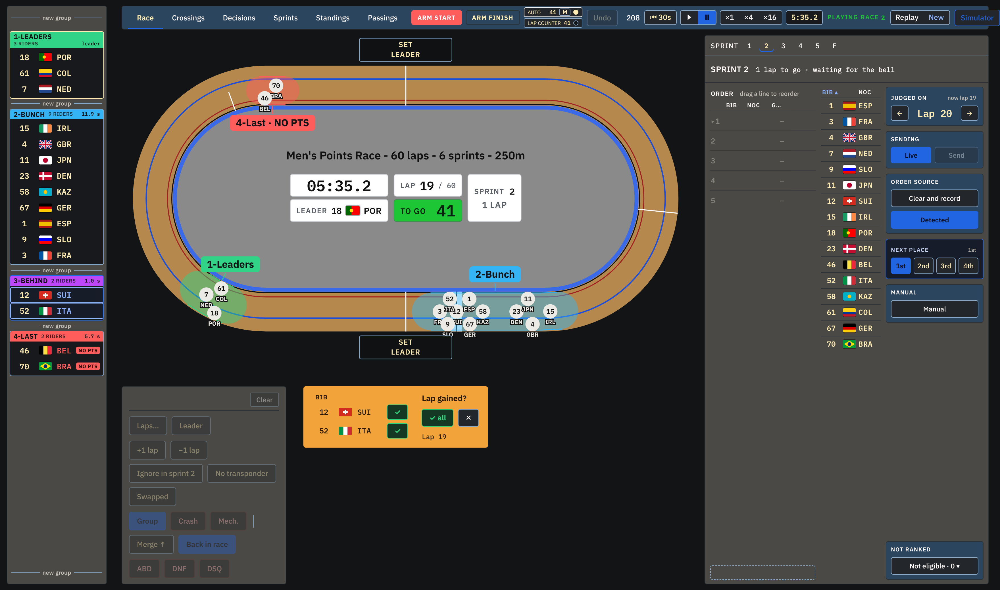

L'écran se lit en cinq zones.

**La barre du haut.** À gauche, les vues de la course, qui donnent accès aux différentes lectures sans jamais quitter la course. Au centre, les commandes de lecture du simulateur : marche, pause, vitesse (×1, ×4, ×16), l'horloge de course, et les boutons pour rejouer ou ouvrir une nouvelle course. À droite, les commandes de la course : « ARM START » et « ARM FINISH » pour armer le départ et l'arrivée, la source des tours restants (l'application qui compte toute seule, ou le compteur du commissaire), le bouton « Undo », et le numéro de build.

**La timeline, à gauche.** Elle montre l'ordre de la course du premier au dernier, réparti en groupes. Chaque groupe porte son numéro, son nom, le nombre de coureurs et son écart : ici « 1-Leaders » en tête (marqué « leader »), puis « 2-Bunch » le peloton à 11,9 s, « 3-Behind » à 1,0 s et « 4-Last » à 5,7 s. Chaque ligne porte le dossard, le drapeau et le code pays d'un coureur. Les coureurs réunis en groupes le sont automatiquement : dès que l'écart entre deux coureurs dépasse le seuil, une cassure crée un nouveau groupe. Les bandes « new group » permettent de poser un groupe à la main. La mention « NO PTS » marque les coureurs qui ne peuvent pas marquer au prochain sprint.

**L'ovale, au centre.** Il montre où sont les coureurs sur la piste à l'instant présent. Les coureurs d'un même groupe portent la même couleur, la même que celle de leur groupe sur la timeline, et on les voit se détacher quand une échappée part. Au milieu, le panneau de course ne garde que ce qui se lit en course : l'horloge, le tour en cours (LAP 19 / 60), le leader, les tours restants (TO GO 41, en vert) et le prochain sprint. Les deux boutons « SET LEADER », placés aux deux points d'armement, servent à désigner le prochain coureur en tête quand le logiciel se trompe.

**La barre d'actions et les propositions, en bas à gauche.** La barre réunit tout ce que l'opérateur peut faire sur un coureur ou un groupe sélectionné : ajouter ou retirer un tour, désigner le leader, écarter un coureur d'un sprint, signaler un changement de transpondeur, un regroupement, une chute, un ennui mécanique, un abandon. À côté, les cartes de proposition : le logiciel a déjà préparé un tour gagné pour les dossards 12 et 52, et l'opérateur n'a plus qu'à valider d'un « ✓ all », corriger ou refuser d'un « ✕ ». C'est le principe du produit : le logiciel prépare, l'opérateur tranche.

**La colonne de sprint, à droite.** Elle n'apparaît qu'autour d'un sprint. Elle montre l'ordre du sprint, la liste de départ pour saisir un coureur à la main, et les commandes d'envoi (en direct ou sur commande), de source de l'ordre, de tour jugé et de saisie manuelle. Elle est détaillée plus bas.

Deux de ces zones, vues de plus près :

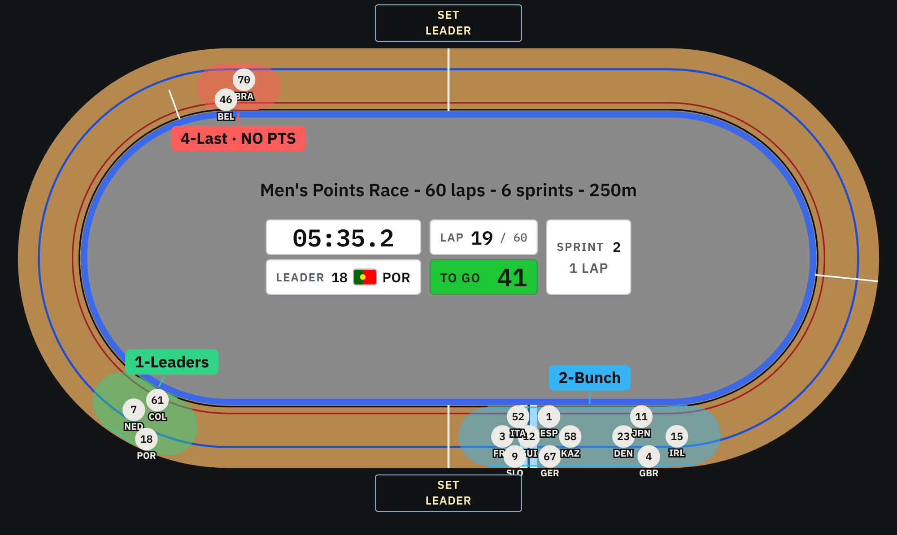

L'ovale : les coureurs placés sur la piste, le peloton étiré, et le panneau central.

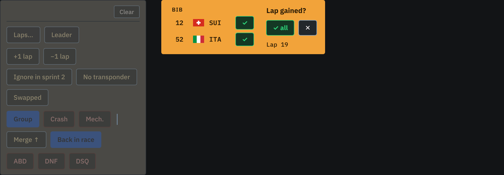

La barre d'actions et la carte « Lap gained? » préparée par le logiciel pour les dossards 12 et 52.

### 10.2 · Les vues de la course

Chaque vue donne une façon de relire ce que le logiciel a enregistré, sans interrompre la course.

**Lap by lap — l'ordre de passage, tour par tour.** C'est le cœur du système. Pour chaque tour, l'ordre dans lequel les coureurs ont franchi la ligne, du premier au dernier. Le logiciel l'a gardé pour tous les tours : il peut donc dire, pour n'importe quel tour, qui est passé dans quel ordre. Les tours de sprint sont surlignés, et le logiciel signale ce qui mérite un œil.

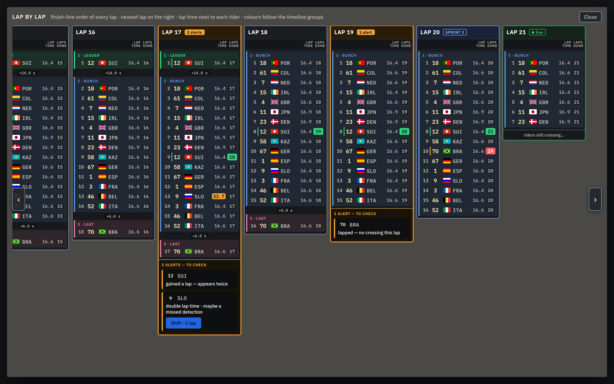

**Race log — le journal de la course.** La « boîte noire » de la course, en langage clair : chaque fait, dans l'ordre, avec l'heure du jour et le temps de course — le départ, les sprints, les tours gagnés et perdus, les regroupements, les abandons, les neutralisations. Chaque entrée porte un type coloré ; les anomalies sont présentées en Problème → Effet → Action, avec une pastille qui dit si c'est réglé, en attente ou ignoré. On trie et on filtre par type. Ce journal sert de preuve en cas de réclamation.

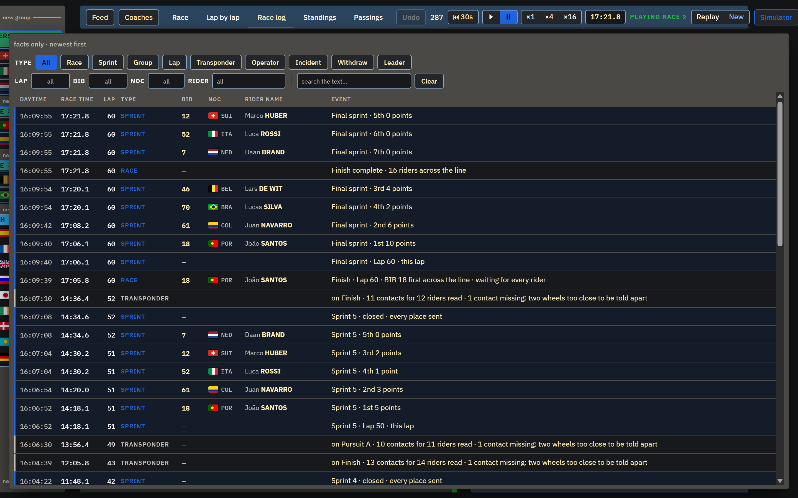

**Sprints — tous les sprints, en entier.** Chaque sprint côte à côte, l'ordre complet des coureurs, les quatre premiers qui marquent, le final qui compte double. On fait défiler de gauche à droite.

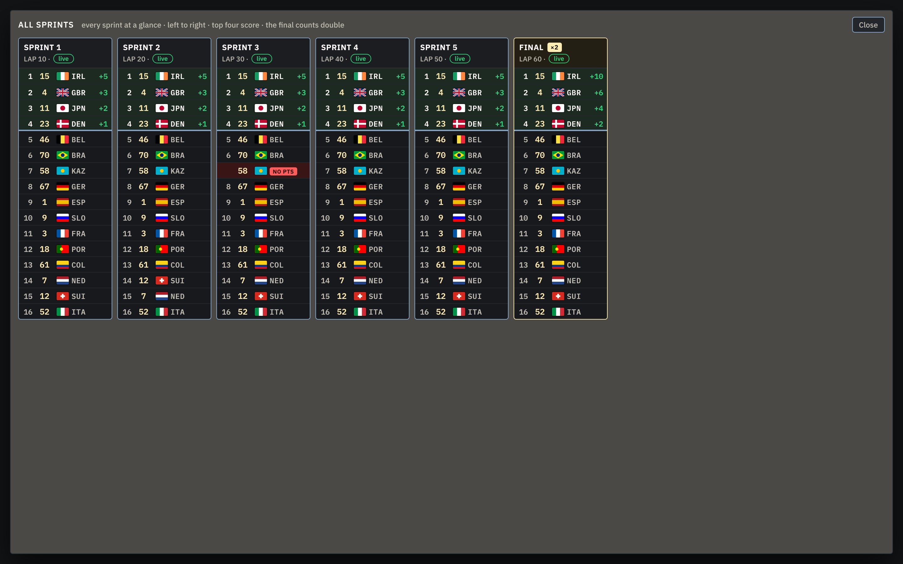

**Standings — le classement, et son évolution.** Le classement complet de la course, large et lisible : rang, dossard, drapeau, nation, nom, total, avec le détail des points — ceux des sprints, ceux des tours gagnés et perdus. Dans une manche de qualification, une ligne de coupe sépare les qualifiés des éliminés.

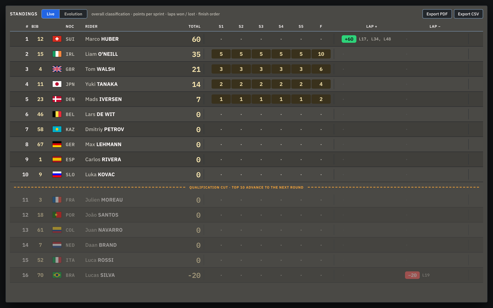

Une seconde lecture montre l'**évolution** du classement : on suit jusqu'à quatre coureurs, on voit leurs points monter au fil des sprints et des tours, et l'écart se creuser ou se réduire entre eux. Un clic sur un moment de la course re-classe le tableau à cet instant.

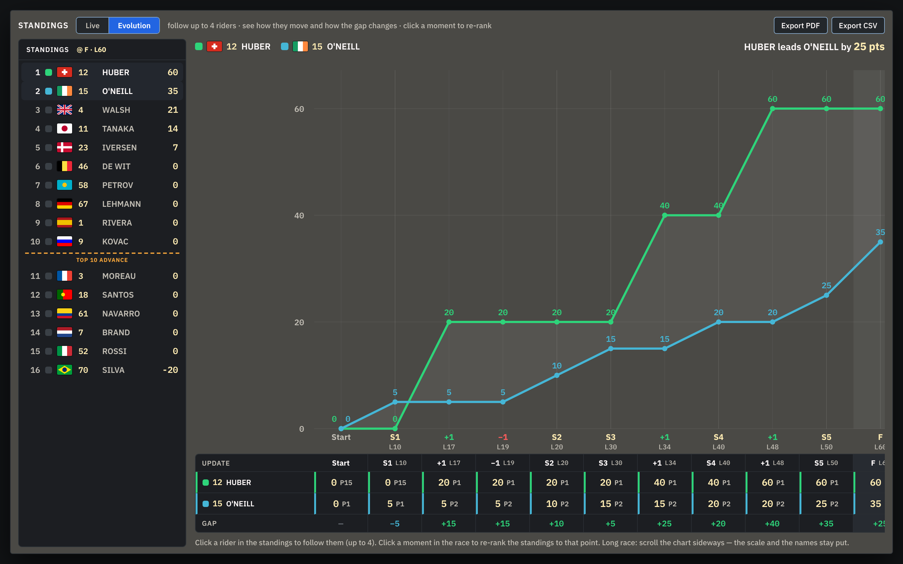

**Passings — toutes les lectures des capteurs.** Le relevé brut de chaque passage : les trois boucles qui lisent les transpondeurs (Finish, Pursuit A, Pursuit B) et les bandes de contact qui comptent les vélos. Chaque ligne est colorée par l'endroit du passage, et les anomalies — un contact sans lecture, une lecture sans contact — ressortent. On trie et on filtre par type et par endroit, et la santé des boucles est affichée.

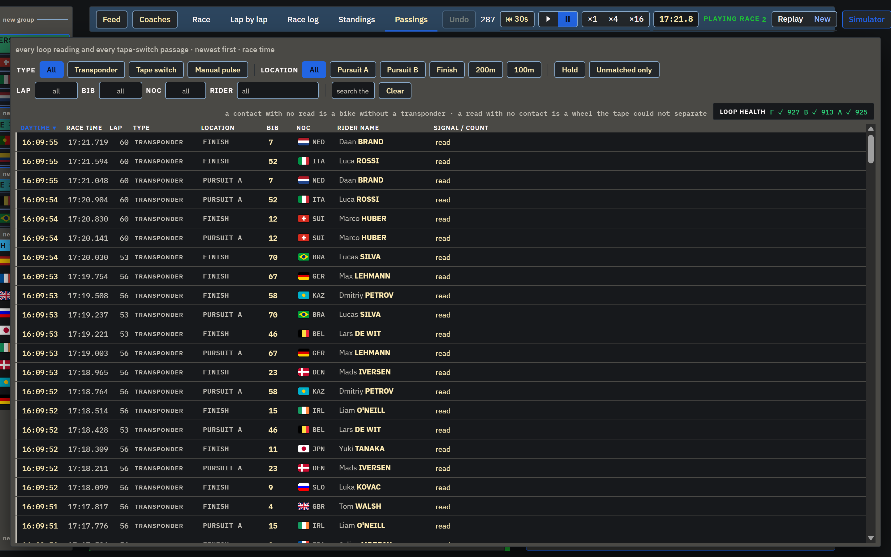

### 10.3 · La carte de sprint en détail

Pour chaque sprint, une carte dédiée affiche le résultat, que l'opérateur peut vérifier et corriger. Ici, le premier sprint, disputé au tour 10 : l'ordre à gauche, la liste de départ au milieu pour ajouter un coureur à la main, et les commandes à droite — le tour sur lequel le sprint est jugé, l'envoi en direct, la source de l'ordre, la place suivante et la saisie manuelle. La bande du haut permet de passer d'un sprint à l'autre.

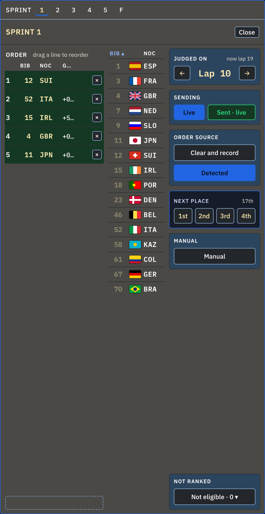

### 10.4 · Les scénarios de course

Le logiciel connaît le classement à tout instant. À l'approche de la fin, il montre ce qui est **encore possible**, en mots simples.

**Ce qui est en jeu.** Pour chaque coureur, les points déjà acquis, ceux qu'il peut encore prendre aux sprints restants, le maximum qu'il peut atteindre et la fourchette de place que ce plafond permet. À côté, les bagarres encore ouvertes — la victoire, le podium, la dernière place qualificative d'une manche — chacune en une phrase.

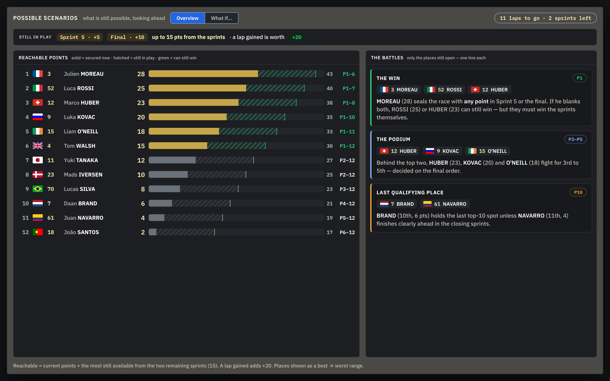

**Le projecteur « what if ».** On pose un ordre d'arrivée pour les sprints qui restent et pour le final, et le classement projeté se recalcule aussitôt — qui monte, qui descend, qui gagne.

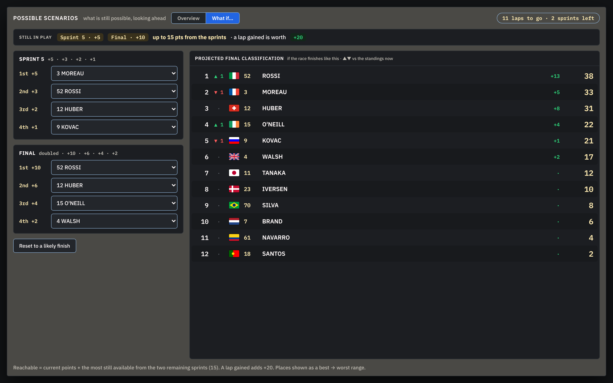

### 10.5 · Le fil commentateurs — neuf vues

Ce que la course envoie aux commentateurs : un fil **automatique**, en lecture seule, alimenté tout seul par ce que l'opérateur valide dans l'écran de course. Il s'ouvre d'un bouton, dans une seconde fenêtre du même poste, et se range en six onglets. Il est en anglais, pour un public international ; dans une manche de qualification, il porte la ligne de coupe.

Rien n'y est saisi et rien n'y est décidé : le commentateur regarde, il ne touche à rien. Aucune des vues qui suivent n'a demandé d'enregistrer quoi que ce soit de plus pendant la course — toutes se construisent sur trois relevés que le logiciel tient déjà : les passages de ligne tour par tour, les lectures des boucles de transpondeurs, et l'ordre complet de chaque sprint.

**La liste de départ.** Qui est au départ, avec le dossard, la nation et le nom. C'est la première chose qu'un commentateur ouvre, et celle qu'il garde à côté de lui pour nommer un coureur sans se tromper.

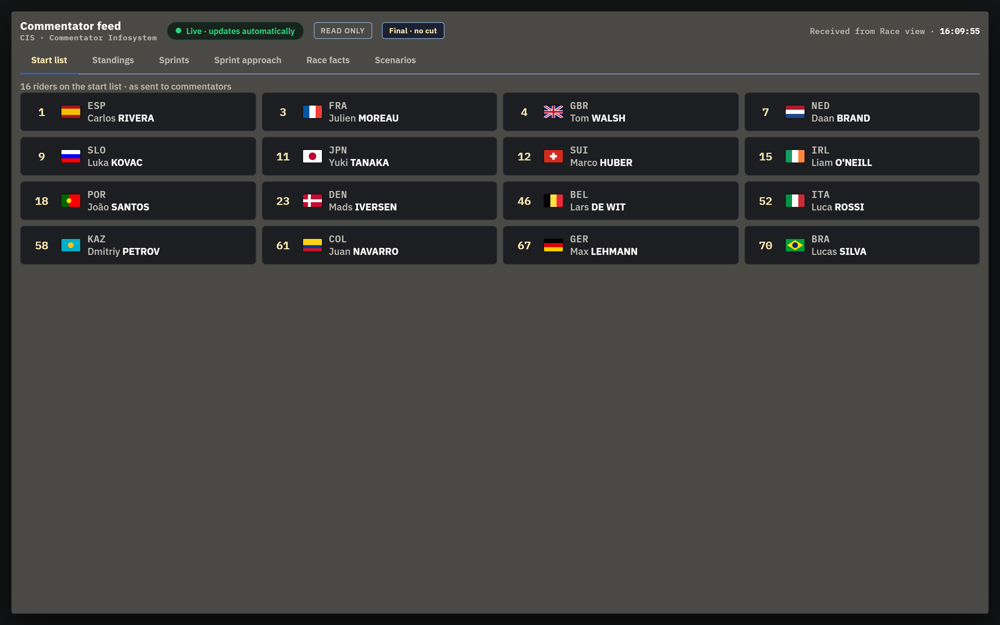

**Le classement, en direct.** Le classement général à l'instant présent : le total, les points gagnés à chaque sprint, les tours gagnés et perdus avec le tour où c'est arrivé, et l'ordre d'arrivée. C'est la vue de référence, celle qui répond à « qui est en tête, et de combien ».

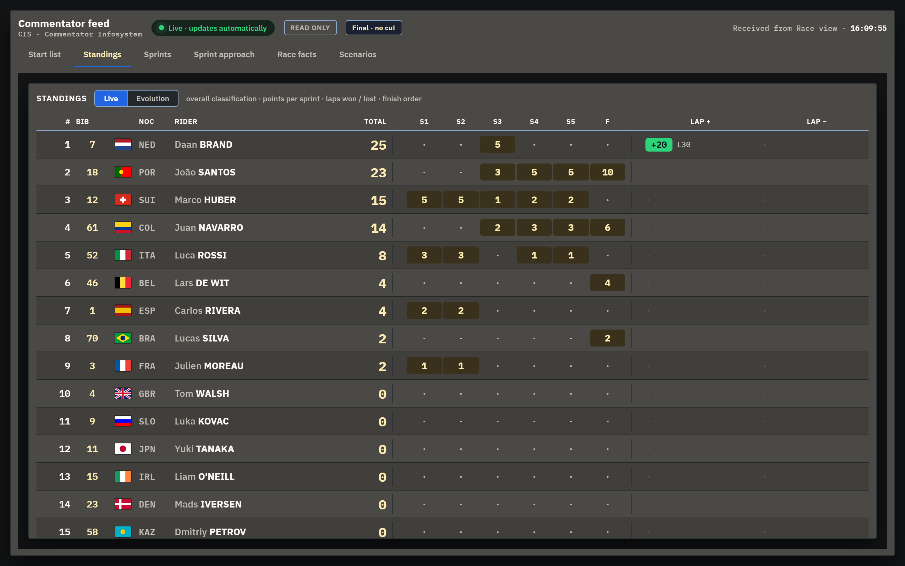

**L'évolution du classement.** La même histoire, mais dans le temps : chaque moment de la course où le classement a bougé — le départ, chaque sprint, chaque tour gagné ou perdu — avec le chemin de quatre coureurs suivis. Elle sert à raconter comment on en est arrivé là, et à montrer le moment où la course a basculé. Un clic sur un moment re-classe le tableau à cet instant.

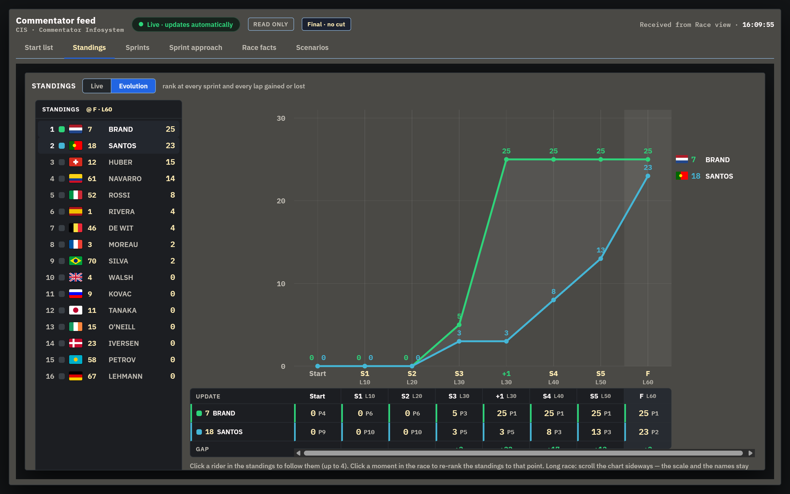

**Les sprints.** Tous les sprints de la course, en entier, de gauche à droite : les quatre places qui marquent, les points, et la finale qui compte double. Elle sert à retrouver d'un coup d'œil qui a marqué où, sans dérouler le classement.

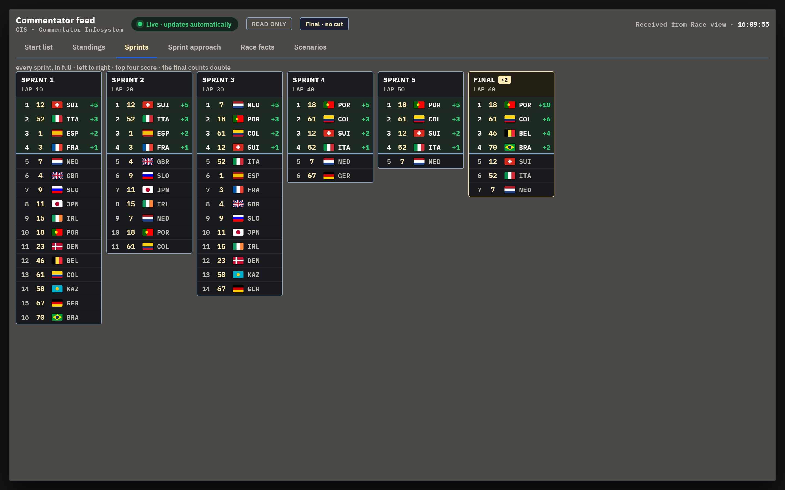

**L'approche du sprint.** Où étaient les coureurs dans les tours qui précèdent le sprint, et comment le sprint s'est joué. Le graphe donne le rang de chaque coureur à chaque relevé — deux par tour, le back straight puis la ligne d'arrivée. À droite, les phrases prêtes à être lues : qui menait à trois tours, qui a remonté dans le dernier demi-tour, qui a tenu. C'est la vue qui répond à « comment a-t-il gagné ce sprint ».

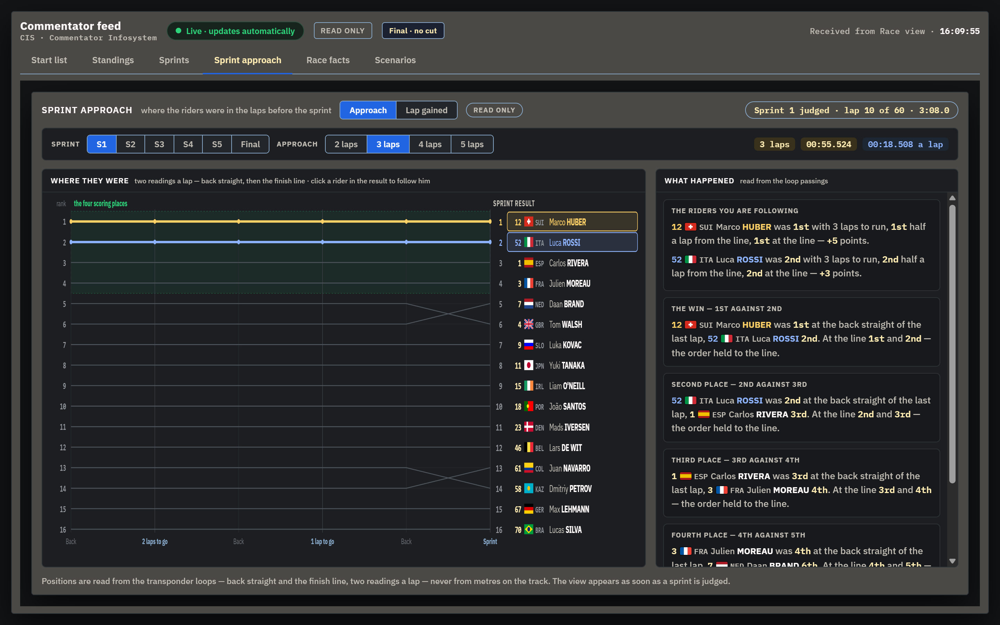

**Le tour gagné.** Ce qu'il a fallu pour prendre un tour, de l'attaque au tour crédité : le tour où il est parti, celui où il s'est détaché, celui où il est revenu sur le peloton, celui où le tour lui a été accordé ; combien de temps a duré le mouvement, de combien il tournait plus vite que le peloton, qui est parti avec lui et combien de temps, et le sprint qui est tombé pendant qu'il était devant.

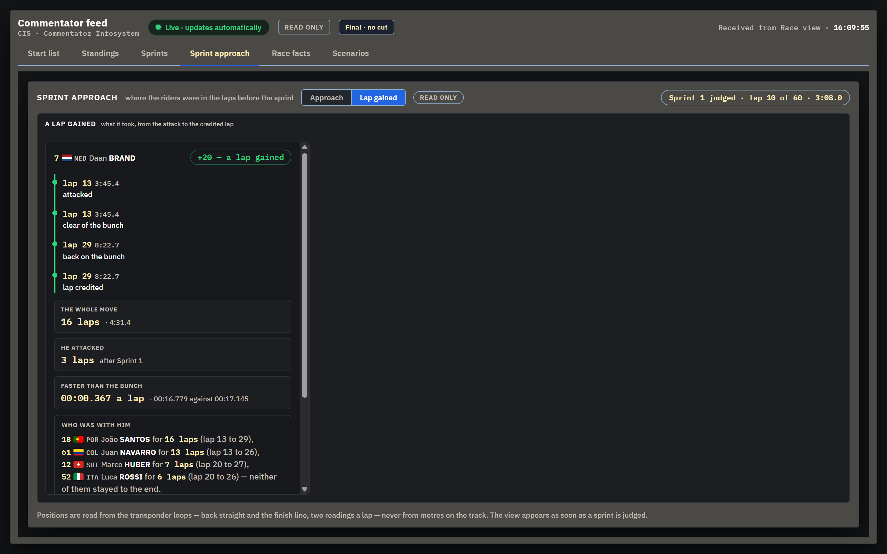

**Les faits de course.** Tout ce que la course a produit, en phrases, rangé par famille : les sprints, les approches, les tours gagnés et perdus, les échappées, les lâchés, le classement, la ligne de coupe, ce qui reste possible, les chutes. Le commentateur filtre la famille qui l'intéresse, ou ne garde que les faits marquants. C'est la vue où l'on va chercher de quoi parler quand la course est calme.

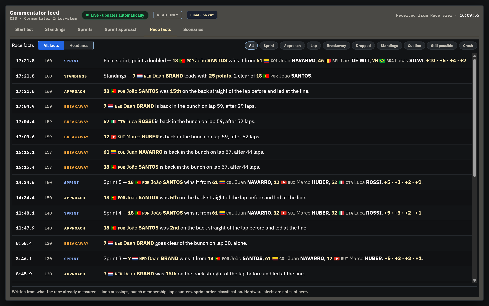

**Les scénarios.** Ce qui est encore possible : combien de points restent en jeu, la meilleure et la pire place encore atteignable pour chaque coureur, et trois batailles suivies à part — la victoire, le podium, la dernière place qualificative. Elle sert à dire ce qui se joue encore, sans se tromper.

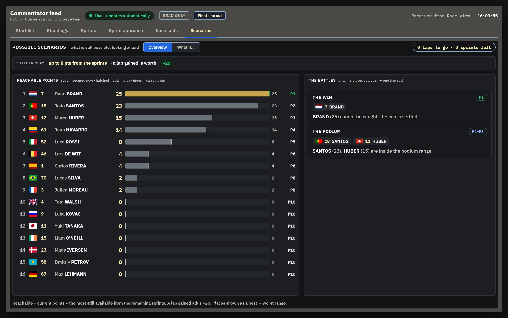

**Le projecteur « what if ».** La même chose, mais jouée : on suppose un résultat pour chaque sprint restant, et le classement se recalcule. C'est la vue qui permet d'annoncer à l'antenne ce qu'il faut à un coureur pour passer devant.

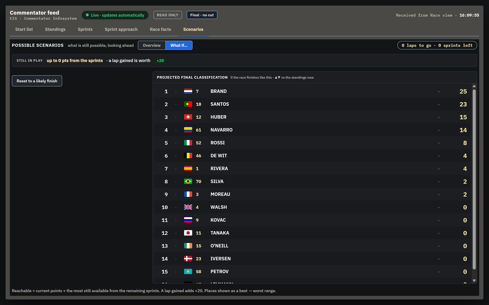

### 10.6 · Le fil entraîneurs — cinq vues

Le même principe, mais pour les entraîneurs, et dans une autre fenêtre : non plus de quoi raconter la course, mais de quoi la décortiquer après coup. Tous les coureurs, tous les sprints, sans choisir. Elle est en lecture seule elle aussi, et lit exactement les mêmes relevés que le fil commentateurs.

**Les graphes, coureur par coureur.** Pour chaque coureur suivi, ses sprints posés côte à côte : la même courbe de rang à chaque sprint de la course. On y lit d'un coup la manière d'un coureur — celui qui remonte toujours dans le dernier tour, celui qui part de loin, celui qui s'use. À l'ouverture, ce sont les quatre premiers du classement qui sont suivis ; on en change d'un clic dans la liste.

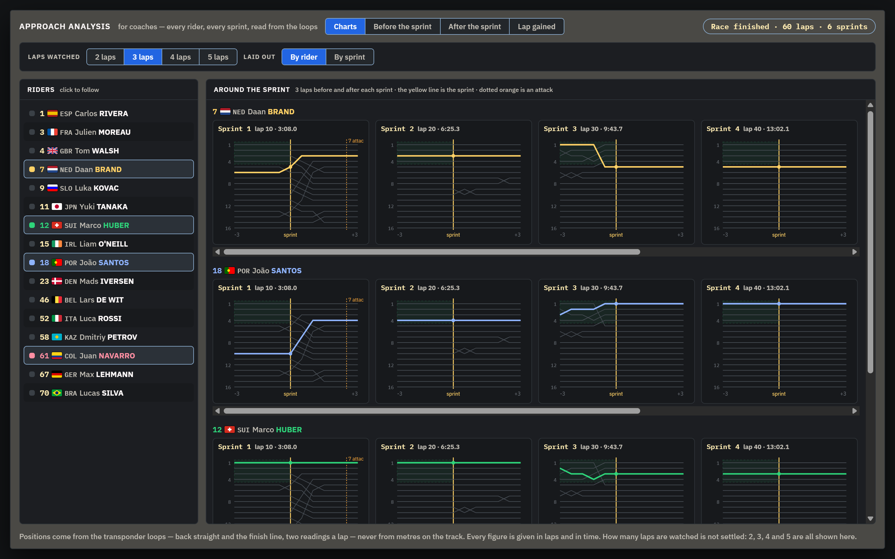

**Les graphes, sprint par sprint.** Les mêmes coureurs, mais un sprint par bande, empilés. On y compare les quatre entre eux à un moment donné, et les attaques tombées dans la fenêtre sont marquées. C'est la disposition qui sert à préparer un sprint : où faut-il être à deux tours de la ligne.

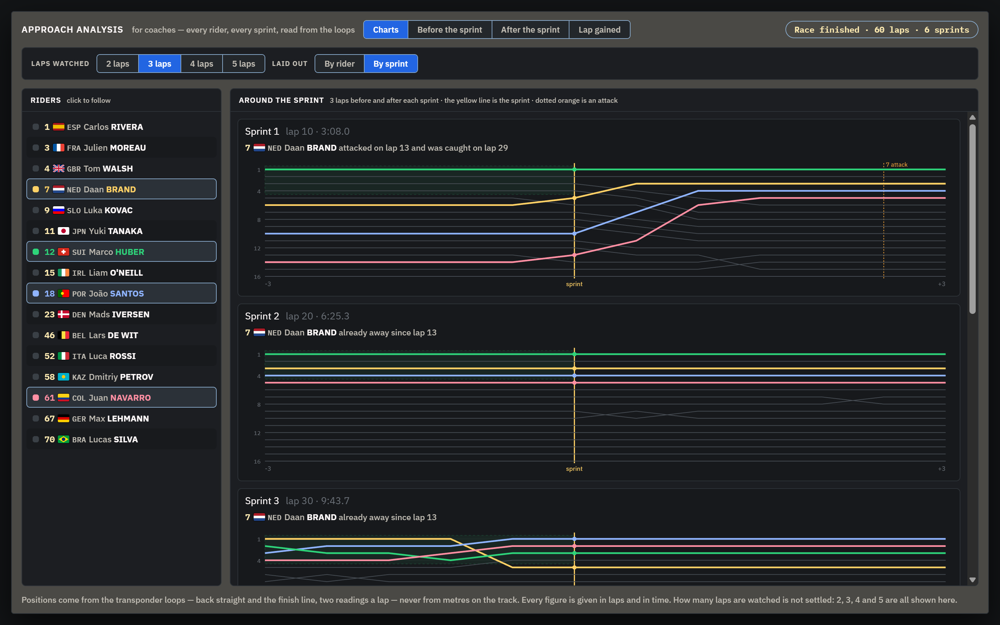

**Avant le sprint.** Le même relevé, mais en chiffres : le rang de chaque coureur à chaque passage des tours qui précèdent le sprint, sprint par sprint, et les points marqués. C'est le tableau qu'on emporte, celui où l'on vérifie une impression.

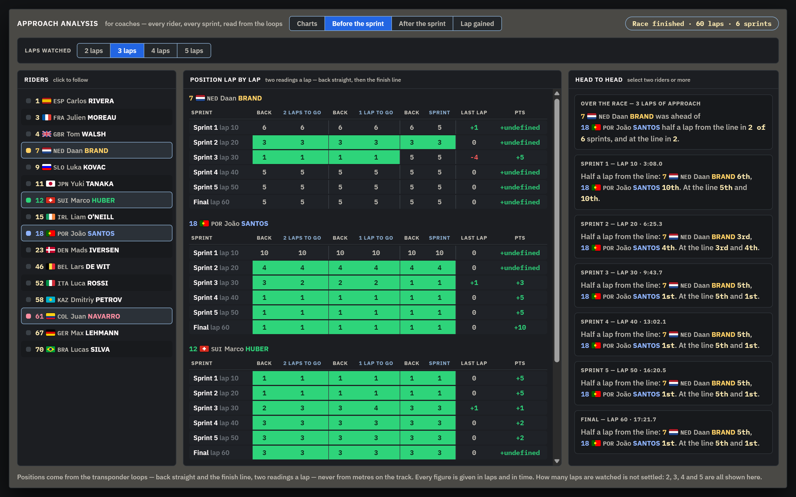

**Après le sprint.** La suite : ce que le coureur a fait dans les tours qui suivent. A-t-il tenu sa place, ou l'effort du sprint lui a-t-il coûté les tours d'après ? C'est la vue de la récupération.

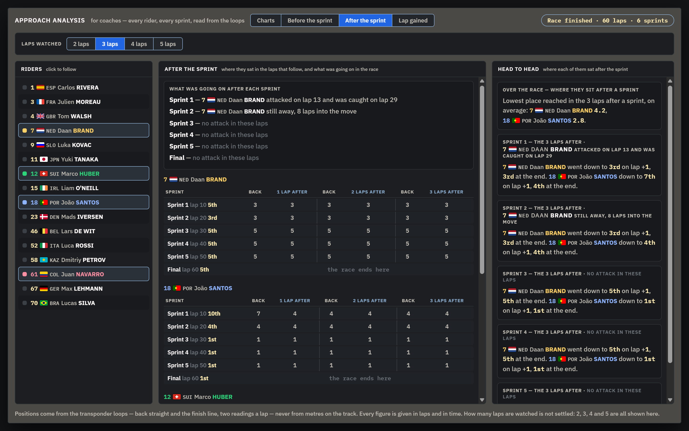

**Le tour gagné.** Le même détail que dans le fil commentateurs, mais pour l'entraîneur : le temps du mouvement, l'écart par tour avec le peloton, les compagnons et ce qu'ils ont tenu, et le temps perdu entre le retour sur le peloton et la décision du président. C'est la vue qui sert à juger si l'effort valait ses vingt points.

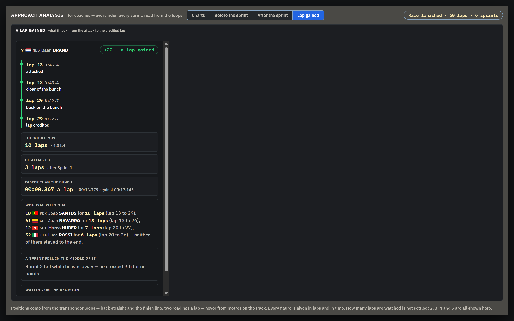

### 10.7 · Le simulateur

Le produit contient un simulateur, qui rejoue des courses enregistrées ou en crée de nouvelles. C'est l'outil qui permet d'éprouver les automatismes sur des situations choisies, des plus calmes aux plus animées. Il se range dans un panneau à droite de l'écran, à côté de la course.

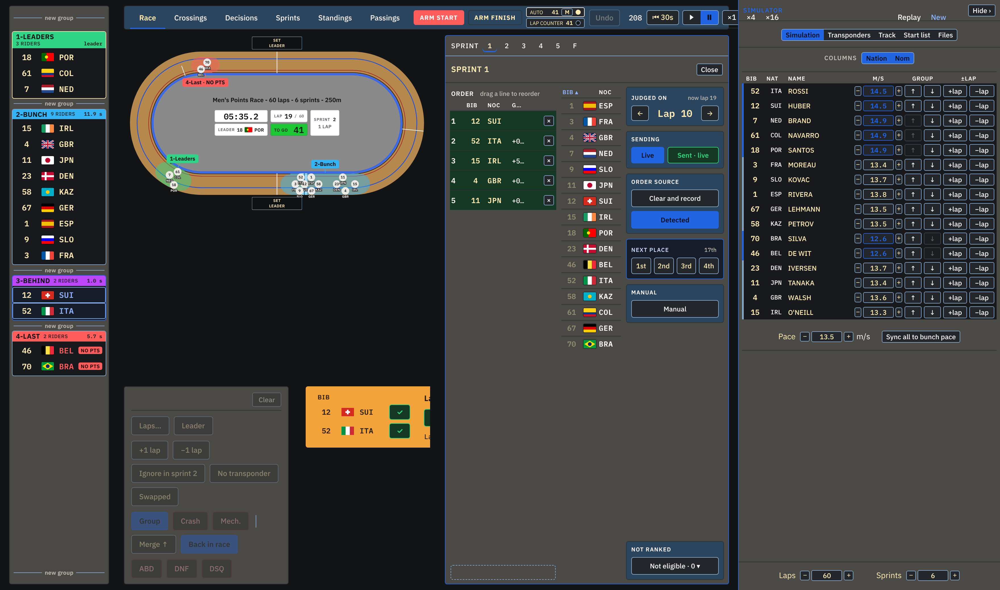

**L'onglet Simulation.** Chaque coureur a sa vitesse réglable, et des boutons pour le faire changer de groupe ou lui faire gagner ou perdre un tour. En bas, le nombre de tours et de sprints de la course. C'est ainsi qu'on compose un scénario : prendre trois coureurs et leur faire gagner un tour, en faire lâcher un autre, régler l'allure du peloton.

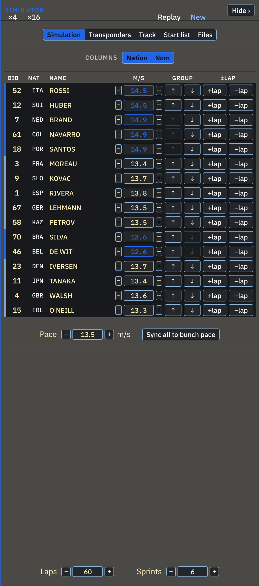

**L'onglet Start list.** La liste des coureurs engagés, avec leur dossard, leur nom et leur nation. C'est aussi cette liste qui, affichée à côté de la fenêtre du classement, permet à l'opérateur de saisir les coureurs quand une course se dispute sans transpondeurs.

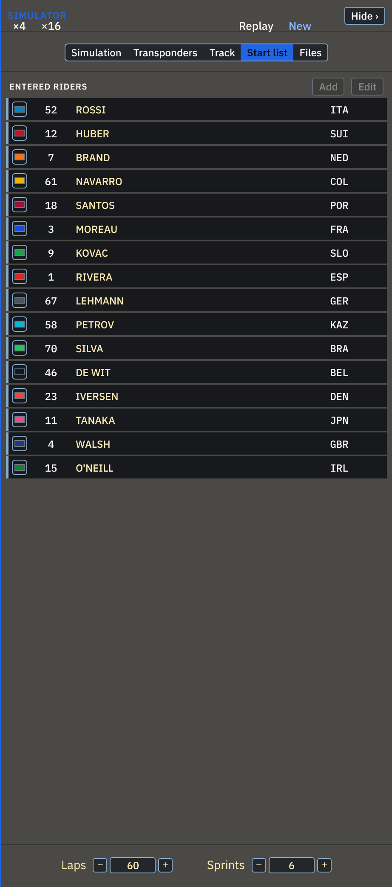

Le panneau comporte en outre un onglet « Transponders », pour l'attribution des transpondeurs, un onglet « Track » pour la piste, et un onglet « Files » pour charger et enregistrer les courses de test.
